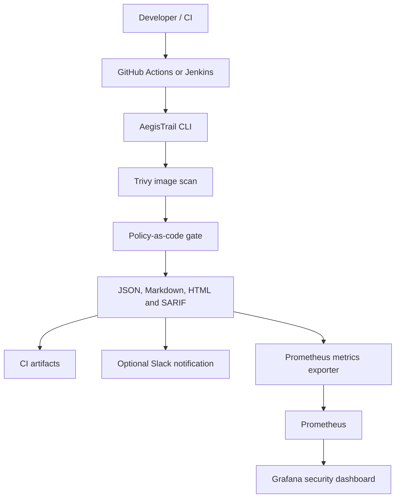

# AegisTrail — Container Security for DevSecOps

**AegisTrail** is an independently designed, policy-driven container-image security gate. It combines Trivy scanning, severity-based policy enforcement, shareable reports, optional Slack alerts, and a Prometheus/Grafana observability stack.

The project is built as a small, understandable capstone that can run locally and plug into GitHub Actions or Jenkins. It uses its own name and implementation.

## Table of contents

- [Project overview](#project-overview)
- [Architecture](#architecture)
- [Features](#features)
- [Technology stack](#technology-stack)
- [Prerequisites](#prerequisites)
- [Quick start](#quick-start)
- [Reports and policy gate](#reports-and-policy-gate)
- [Slack notifications](#slack-notifications)
- [Prometheus and Grafana](#prometheus-and-grafana)
- [Jenkins pipeline](#jenkins-pipeline)
- [GitHub Actions](#github-actions)
- [Testing and linting](#testing-and-linting)
- [Project structure](#project-structure)
- [Security notes and scope](#security-notes-and-scope)
- [Roadmap](#roadmap)

## Project overview

Container images can include vulnerable operating-system packages and application dependencies. AegisTrail runs Trivy against a chosen image, converts the findings into a normalized report, and evaluates them against a version-controlled policy. A policy failure returns a non-zero exit code so that a CI/CD pipeline can block promotion.

The project creates a human-friendly HTML summary, Markdown and JSON output, and SARIF for GitHub Code Scanning. The metrics exporter exposes the most recently generated report to Prometheus; a provisioned Grafana dashboard visualizes its severity counts and gate status.

## Architecture

The report files can be archived in CI and sent to an optional Slack webhook. The latest JSON report is read by the AegisTrail metrics exporter, scraped by Prometheus, and visualized in Grafana.

## Features

### Container-image scanning
- Uses Trivy to scan a container image for known vulnerabilities.
- Normalizes findings into image, target, package, version, severity, and vulnerability ID fields.
- Preserves the raw Trivy JSON for investigation.

### Policy-as-code security gate
- Configure blocking and report severities in policy.toml.
- Default policy fails the scan on **HIGH** or **CRITICAL** findings.
- **UNKNOWN** findings remain visible for triage but do not block by default.
- The command exits with 0 on pass, 2 when policy blocks, and 1 for scan/report errors.

### Multi-format reporting
Each successful Trivy execution creates:
- **artifacts/results.json** — structured summary and findings.
- **artifacts/summary.md** — concise Markdown report.
- **artifacts/summary.html** — self-contained HTML report with severity cards and finding details.
- **artifacts/results.sarif** — Trivy native SARIF output for compatible code-scanning tools.
- **artifacts/trivy-raw.json** — original Trivy JSON report.

### CI/CD integrations
- GitHub Actions runs lint and unit tests on pushes and pull requests.
- A manual GitHub Actions run scans the selected image, enforces policy, uploads SARIF, and stores report files as an artifact.
- Jenkinsfile provides a declarative pipeline for linting, tests, image scanning, and report archiving.

### Notifications and observability
- Optional Slack incoming-webhook notification summarizing the image, gate result, and severity counts.
- A lightweight built-in HTTP exporter exposes the current report in Prometheus text format at /metrics.
- Prometheus scrape configuration and alert rules are included.
- Grafana datasource provisioning and a dashboard are included for severity counts and gate status.
- Docker Compose runs the local exporter, Prometheus, and Grafana services together.

## Technology stack

| Technology | Role in AegisTrail |
|---|---|
| Python 3.11+ | CLI, policy logic, report generation, metrics endpoint |
| Trivy | Container-image vulnerability detection and native SARIF conversion |
| GitHub Actions | Pull-request/push checks and manual image scans |
| Jenkins | Optional declarative CI/CD pipeline |
| Slack incoming webhook | Optional scan notifications |
| Prometheus | Scrapes metrics and evaluates alert rules |
| Grafana | Dashboard visualization |
| Docker Compose | Runs the local monitoring stack |
| pytest and Ruff | Unit tests and linting |

## Prerequisites

For local scanning:
- Python 3.11 or newer.
- Trivy installed and accessible on PATH.
- Git.

For the monitoring stack:
- Docker Desktop or Docker Engine with the Compose plugin.
- One completed scan with an artifacts/results.json file.

For Jenkins:
- A Jenkins agent with Python 3.11+, pip, Git, and Trivy installed.
- Permission to pull the image being scanned.

## Quick start

### 1. Clone the repository

    git clone https://github.com/Rahul-17personal/capstone-devsecops-project.git
    cd capstone-devsecops-project

### 2. Create a virtual environment

Windows PowerShell:

    python -m venv .venv
    .\.venv\Scripts\Activate.ps1

Linux/macOS:

    python3 -m venv .venv
    source .venv/bin/activate

### 3. Install the project and development tools

    python -m pip install -e ".[dev]"

Verify that Trivy is installed:

    trivy --version

### 4. Run tests and lint

    pytest
    ruff check .

### 5. Scan an image

    python -m aegistrail scan --image alpine:3.24 --policy policy.toml --out-dir artifacts

A scan can correctly exit with code 2 when the configured policy finds a blocking vulnerability. Review the generated reports rather than treating every non-zero exit as a scanner crash.

## Reports and policy gate

The default policy in policy.toml is:

    fail_on_severity = ["HIGH", "CRITICAL"]
    report_severity = ["UNKNOWN", "HIGH", "CRITICAL"]
    minimum_findings_to_fail = 1

Edit these settings to tune the gate for your team's risk tolerance. The report_severity option controls which finding details appear in the reports; severity totals still count all detected findings.

| Exit code | Meaning |
|---:|---|
| 0 | Scan completed and policy passed |
| 1 | Trivy, input, or report-generation error |
| 2 | Scan completed, but the configured policy blocked it |

## Slack notifications

A Slack incoming webhook is optional. Configure it as an environment variable; do not put the real URL in source control.

Windows PowerShell:

    $env:AEGISTRAIL_SLACK_WEBHOOK_URL = "https://hooks.slack.com/services/REPLACE/ME"

Linux/macOS:

    export AEGISTRAIL_SLACK_WEBHOOK_URL="https://hooks.slack.com/services/REPLACE/ME"

Then run a scan as usual. If the variable is set, AegisTrail posts the status and severity counts to Slack. A webhook delivery failure prints a warning but does not override the image policy result.

## Prometheus and Grafana

AegisTrail includes a metrics command and a ready-to-run local monitoring stack.

### 1. Generate a report first

Use the Quick start instructions to create artifacts/results.json. The exporter reads the latest report snapshot; it does not rerun Trivy continuously.

### 2. Set local Grafana credentials

Copy .env.example to .env and replace the sample password.

Windows PowerShell:

    Copy-Item .env.example .env

Linux/macOS:

    cp .env.example .env

### 3. Start the services

Run from the repository root:

    docker compose up --build -d
    docker compose ps

Open the local interfaces:

| Service | URL | Purpose |
|---|---|---|
| AegisTrail metrics | [http://localhost:8000/metrics](http://localhost:8000/metrics) | Prometheus metrics |
| Prometheus | [http://localhost:9090](http://localhost:9090) | Queries, scrape status, alert rules |
| Grafana | [http://localhost:3000](http://localhost:3000) | Provisioned dashboard |

Grafana uses the username and password from .env. If .env was not created, Compose uses a development fallback password. Create .env and change it before starting the stack. Ports are bound to loopback and are not intended as production deployment settings.

The included dashboard is named **AegisTrail Security Overview**. Prometheus alert rules identify critical findings and policy failures. The rules appear in Prometheus; sending alerts externally requires Alertmanager or another notification integration.

To stop the stack:

    docker compose down

Named Prometheus/Grafana data volumes are retained. To delete those monitoring volumes too, use docker compose down -v intentionally.

### Run the exporter without Docker

    python -m aegistrail serve-metrics --reports-dir artifacts --host 127.0.0.1 --port 8000

Prometheus should target the machine and port where this exporter runs. In Docker Compose, the target is already configured as aegistrail-metrics:8000.

## Jenkins pipeline

The repository root contains a declarative Jenkinsfile. It checks for Python and Trivy, installs the package, runs Ruff and pytest, scans the image selected by the IMAGE_TO_SCAN build parameter, and archives artifacts/**.

Configure the Jenkins agent with Python 3.11+, pip, Git, and Trivy, then create a Pipeline job from this repository. To enable Slack notifications in Jenkins, set AEGISTRAIL_SLACK_WEBHOOK_URL through Jenkins credentials/environment configuration; the pipeline does not include or require a real webhook secret.

## GitHub Actions

The workflow is .github/workflows/security-scan.yml.

- **Push / pull request:** installs the package, runs Ruff, and executes offline unit tests.
- **Manual image scan:** open **Actions → AegisTrail Container Security → Run workflow**, select an image reference (default alpine:3.24), and start the workflow.
- **Artifacts:** the image-scan job uploads JSON, Markdown, HTML, raw Trivy output, and SARIF.
- **Code Scanning:** SARIF upload requires the repository's GitHub Code Scanning feature to be available and enabled.

The image scan is deliberately manual so ordinary pushes do not unexpectedly wait on a registry scan or fail due to the selected image's vulnerabilities.

## Testing and linting

Run local checks:

    ruff check .
    pytest

Unit tests use synthetic Trivy JSON and temporary report files. They do not require Docker, a live image registry, Slack credentials, or a running Prometheus/Grafana stack.

## Project structure

    .
    ├── .github/workflows/security-scan.yml
    ├── observability/
    │   ├── alert_rules.yml
    │   ├── prometheus.yml
    │   └── grafana/
    │       ├── dashboards/aegistrail-overview.json
    │       └── provisioning/
    │           ├── dashboards/dashboards.yml
    │           └── datasources/prometheus.yml
    ├── src/aegistrail/
    │   ├── cli.py
    │   ├── html_report.py
    │   ├── metrics.py
    │   ├── models.py
    │   ├── notifications.py
    │   ├── policy.py
    │   ├── reports.py
    │   └── trivy.py
    ├── tests/
    ├── Dockerfile
    ├── Jenkinsfile
    ├── docker-compose.yml
    ├── policy.toml
    └── pyproject.toml

## Security notes and scope

- Trivy performs vulnerability detection. AegisTrail applies its own configurable policy and formats the results; it is not a replacement vulnerability database.
- Results depend on the image and Trivy database available at scan time. A successful scan is not proof that an image is secure.
- The monitoring stack visualizes the **latest report snapshot**, not a historical series of every scan.
- Slack webhooks are secrets. Configure them through environment variables or your CI secret store.
- The local Compose stack is for development/demo use. Review authentication, network exposure, image versions, persistence, and secret management before shared or production deployment.
- Current scan scope is container-image vulnerabilities. Source-code, secrets, infrastructure-as-code, Kubernetes posture, image signature verification, and automatic remediation are not yet implemented.

## Roadmap

- Store scan history so Grafana can show actual changes between runs.
- Add source-code, secret, and infrastructure-as-code scanning.
- Add image signature/provenance checks.
- Improve remediation guidance and report filtering.
- Add integration tests for Docker Compose and configurable Alertmanager delivery.
